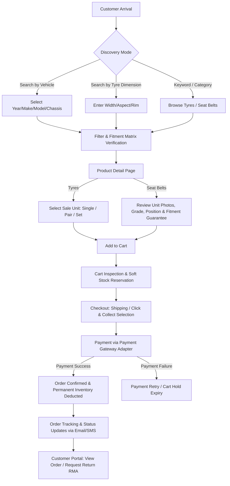

# Project Overview: Pinnacle Automotive Parts E-Commerce

## 1. Business Background & Problem Statement

Pinnacle E-Commerce is a specialized e-commerce platform engineered specifically for the automotive replacement parts industry. Automotive parts retail presents unique challenges that generic e-commerce platforms handle poorly:

1. **Diverse Inventory Modalities**: Commodity components (e.g., brand-new tyres) are sold by quantity from bulk stock with flexible pack configurations (singles, pairs, full vehicle sets of 4), while specialized safety and reclaimed components (e.g., used or refurbished seat belts) are individually serialized, unique physical units requiring high-resolution photos of the actual item, condition grading, and integrity notes.
2. **High-Stakes Fitment Accuracy**: Purchasing an incompatible automotive part results in high return rates, customer frustration, installation delays, and potential safety liabilities (especially regarding seat belts, pretensioners, and airbag connectors). Fitment verification must be an integrated, first-class citizen in the browsing, cart, and ordering workflows.
3. **Operational Clarity**: Warehouse staff, sales dispatchers, customer service representatives, and business managers require distinct, permission-controlled views into catalogue management, physical stock movements, picking/packing, returns inspection, and financial margins.

The platform is designed to provide a fast, trustworthy, restrained customer purchasing experience paired with a robust, auditable administrative back-office.

---

## 2. Reference Site vs. Proposed Implementation

When analyzing reference automotive e-commerce websites (e.g., retail tyre portals, auto dismantlers, or parts aggregators):

- **Observed Reference-Site Behaviour**:
  - Vehicle selector ("Year / Make / Model / Submodel / Engine") sits prominently on the home page and header.
  - Tyre search allows two primary entry points: search by tyre dimensions (`Width / Aspect Ratio / Rim / Speed Rating / Load Index`) or search by vehicle registration / fitment.
  - Tyre product pages allow selecting sale quantities (Single, Pair of 2, Set of 4) with dynamic bulk pricing adjustments.
  - Used parts pages showcase unique stock numbers (Stock ID), high-definition photos of the exact physical unit, vehicle donor details (VIN/chassis if available), and condition ratings.
  - Checkout flows require explicit confirmation of vehicle compatibility or fitment disclaimers.
- **Our Proposed Implementation**:
  - **No Assumptions on Reference Architecture**: We do not copy opaque legacy backend patterns, proprietary CMS plugins, or direct database connections from third-party sites.
  - **Clean Modular Monolith**: Built from the ground up using TypeScript, Next.js (App Router), NestJS, and PostgreSQL via Prisma.
  - **Decoupled Architecture**: Separation of catalogue definition from physical inventory and sale units, ensuring that multi-unit tyre sales accurately deplete single base inventory units without synchronization errors.
  - **Guaranteed Security & RBAC**: Every administrative mutation, stock adjustment, and price reveal is guarded by fine-grained permissions at the API layer.

---

## 3. User Groups & Actors

| User Group                          | Description                                             | Primary Interfaces                      | Key Goals                                                                                                                        |
| ----------------------------------- | ------------------------------------------------------- | --------------------------------------- | -------------------------------------------------------------------------------------------------------------------------------- |
| **Guest Shopper**                   | Unauthenticated retail customer                         | Public Storefront                       | Search parts by vehicle/dimension, verify fitment, add to cart, check out as guest or create account.                            |
| **Registered Customer**             | Authenticated consumer (B2C)                            | Customer Portal & Storefront            | Manage garage (saved vehicles), track order status, view invoices, request returns (RMA), manage addresses.                      |
| **Trade Customer (B2B)**            | Commercial workshop / mechanic _(Pending Confirmation)_ | B2B Storefront & Portal                 | Order in bulk, view trade pricing, access fast re-order lists, manage purchase orders.                                           |
| **Catalog Manager**                 | Internal product specialist                             | Admin Dashboard                         | Maintain category trees, attribute schemas, catalogue definitions, fitment rules, media assets, and SEO metadata.                |
| **Inventory / Warehouse Staff**     | Internal warehouse operator                             | Admin Dashboard (Inventory/Fulfillment) | Inward bulk tyre stock, register & serialize used seat belts, record condition/photos, adjust bin locations, pick & pack orders. |
| **Sales & Order Manager**           | Internal sales/fulfillment lead                         | Admin Dashboard (Orders)                | Monitor order queue, review flagged/held orders, manage dispatch, assign carriers, handle order modifications.                   |
| **Customer Support Representative** | Frontline customer agent                                | Admin Dashboard (Support)               | Look up customer orders, verify fitment queries, initiate returns/RMAs, apply authorized credits/refunds.                        |
| **Business Admin / Owner**          | Executive & store management                            | Admin Dashboard (Full Access)           | Access financial reports, configure store policies, manage staff accounts and RBAC permissions, review audit logs.               |

---

## 4. Initial Product Categories

### Category 1: Tyres

- **Nature of Stock**: Quantity-tracked, new/bulk inventory.
- **Key Specifications**:
  - Section Width (e.g., 205, 225, 255 mm)
  - Aspect Ratio (e.g., 45, 50, 55, 65)
  - Rim Diameter (e.g., 15", 16", 17", 18", 19", 20")
  - Load Index (e.g., 91, 94, 98)
  - Speed Rating (e.g., H, V, W, Y)
  - Season / Terrain (Summer, Winter, All-Season, Highway Terrain, All-Terrain, Mud-Terrain)
  - Run-Flat indicator (Yes / No)
  - Commercial / Light Truck rating (e.g., 'C' or 'XL' Extra Load)
  - Fuel Efficiency, Wet Grip, and Noise Rating (where standard labels apply)
- **Sale Unit Rules**:
  - Sold as **Single (1)**, **Pair (2)**, or **Set of 4**.
  - A single catalogue SKU links to a single physical inventory pool. Selling 1 set of 4 automatically reserves/deducts 4 units of base inventory.

### Category 2: Seat Belts

- **Nature of Stock**: Individually tracked physical units (OEM surplus, recycled, or certified refurbished).
- **Key Specifications**:
  - Vehicle Fitment: Make, Model, Generation/Year Range, Body Style, Chassis Code.
  - Position: Front Left (Driver/Passenger depending on LHD/RHD), Front Right, Rear Left, Rear Right, Rear Center, Third Row.
  - Component Type: Lap belt, 3-point retractor, pretensioner assembly, buckle/stalk assembly.
  - Webbing Color / Trim code.
  - Pretensioner / Pyrotechnic Status (Fired, Active/Tested, Not Applicable).
  - Condition Grade (e.g., Grade A - Like New, Grade B - Minor Wear, Grade C - Noticeable Cosmetical Blemishes, Fully Functional).
  - Condition Notes: Specific physical inspection observations.
  - Multi-Angle Photos: Actual photographs of the exact serialized unit in stock, including label part numbers and buckle condition.
  - Fitment Verification Status: Verified OEM direct replacement vs unverified aftermarket.
- **Sale Unit Rules**:
  - Sold as individual unique items (Quantity = 1 per serialized stock unit). Once sold or reserved, the specific unit is unavailable for other buyers.

---

## 5. End-to-End Customer Journeys

### Detailed Customer Journey Steps

1. **Discovery & Vehicle Matching**:
   - Customer searches via vehicle selector or dimensional specs.
   - The platform filters catalogue items and displays a clear fitment badge ("Guaranteed Fit for 2018 Toyota RAV4" or "Universal Fitment - Verify Specifications").
2. **Product Page & Unit Selection**:
   - For tyres: Customer chooses pack size (single, pair, set) with clear unit price and total price display.
   - For seat belts: Customer inspects the exact item pictures, checks the vehicle position diagram, reviews condition grade notes, and sees safety notices.
3. **Cart & Stock Reservation**:
   - Adding an item to the cart checks live stock availability.
   - During checkout, a temporary soft reservation (e.g., 15 minutes) prevents race conditions for scarce serialized seat belts.
4. **Checkout & Payment**:
   - Streamlined multi-step or single-page checkout collecting shipping address, delivery method (standard shipping, express shipping, or local depot pickup), and contact details.
   - Card/online payment executed through an isolated payment adapter.
5. **Post-Purchase & RMA Support**:
   - Customer receives automated confirmation and tracking numbers upon dispatch.
   - If an item doesn't fit or arrives damaged, the customer submits an RMA return request with photographic evidence through their account portal.

---

## 6. Staff Operations & Workflows

### Workflow 1: Intake & Stock Inwarding

- **Tyres**: Warehouse staff receives a bulk container. They scan/select the tyre product SKU, enter the received batch quantity, unit cost price, warehouse/aisle/shelf location, and generate batch barcode labels.
- **Seat Belts**: Warehouse staff receives used vehicle parts. They create an individual serialized inventory record (`SerializedInventoryItem`), capture unique photos via camera upload, assign a condition grade, document webbing/buckle status, map vehicle donor details, and assign an individual bin location.

### Workflow 2: Order Fulfillment (Pick, Pack, Ship)

- Order status changes to `Paid`.
- Warehouse queue generates a prioritized Pick List grouped by location bin.
- Staff picks items:
  - For tyres: Pulls required base units according to the ordered sale unit (e.g., 2 units for a pair).
  - For seat belts: Scans the exact serialized stock barcode to guarantee the correct physical unit is packed.
- Packing slip and courier shipping label generated via Shipping Carrier Adapter.
- Tracking number recorded; order transitions to `Shipped`; customer notified automatically.

### Workflow 3: Inventory Audit & Adjustments

- Periodic cycle counts compare physical inventory with system records.
- Any discrepancy requires a formal adjustment transaction with a mandatory reason code (e.g., `DAMAGED_IN_WAREHOUSE`, `COUNT_DISCREPANCY`, `SCRAPPED_DEFECTIVE`).
- Cost price adjustments and write-offs over a configured threshold trigger audit alerts and require Business Admin permission.

### Workflow 4: Return Authorization (RMA) & Inspection

- Support team reviews customer RMA request and photos.
- If approved, a return authorization number and return instructions are sent to the customer.
- Upon physical arrival at the warehouse, staff inspects the returned part:
  - If verified in original condition: Unit is restocked to inventory and a refund is triggered.
  - If damaged or mismatched: Unit is rejected or written off to scrap, with notes recorded in the audit trail.

---

## 7. Explicit Out-of-Scope Items (Release 1)

To ensure strict delivery discipline and eliminate speculative complexity, the following capabilities are explicitly deferred from the initial production release:

1. **Third-Party Marketplace Functionality**: No external seller onboarding, multi-vendor payout splits, or merchant self-service portals. The platform is operated solely by Pinnacle as the primary retailer.
2. **Tyre Fitting / Workshop Booking Network**: No integration with external mobile tyre fitters or garage bay reservation scheduling systems. All items are dispatched as physical goods or collected at depot.
3. **Automated Live VIN Decoding APIs**: No automated paid VIN decoding subscriptions (e.g., Carfax / RedBook VIN lookup) until commercial terms and API contracts are finalized. Fitment relies on an internal curated Year-Make-Model database.
4. **Distributed Microservices / Kubernetes**: No microservice mesh, event bus orchestration (Kafka), or Kubernetes deployments. The application is strictly a NestJS modular monolith with PostgreSQL.
5. **Dynamic Machine-Learning Pricing**: No automated algorithmic repricing scraping competitor sites.
