# Project Status: Pinnacle Automotive Parts E-Commerce

## 1. Project Overview & Governing Principles

Pinnacle E-Commerce is a production-minded automotive replacement parts e-commerce platform. It is engineered as a **modular monolith** with strict domain boundaries, fine-grained permission-based RBAC, and decoupled physical inventory and sale units.

The initial product catalog focuses on two core categories:

1. **Tyres**: Bulk quantity-tracked inventory sold across configurable sale units (Single, Pair of 2, Set of 4) that consume shared base stock units.
2. **Seat Belts**: Individually serialized used/refurbished safety components tracked by unique stock barcode, condition grade, condition notes, actual multi-angle inspection photographs, and vehicle fitment verification.

---

## 2. Complete Phase Roadmap & Status Checklist

| Phase        | Description                                                   | Deliverables                                                                                                                                       |    Status     |
| ------------ | ------------------------------------------------------------- | -------------------------------------------------------------------------------------------------------------------------------------------------- | :-----------: |
| **Phase 0**  | **Repository Audit & Architecture**                           | Complete audit, architecture specs, domain model, role-permission matrix, ADRs, open decisions.                                                    | **COMPLETED** |
| **Phase 1**  | **Monorepo Foundation & Workspace Setup**                     | Workspace setup (`apps/web`, `apps/api`, `packages/*`), strict TypeScript, Docker Compose, CI pipeline.                                            | **COMPLETED** |
| **Phase 2**  | **Design System & Application Shells**                        | Design tokens, shadcn/ui components, storefront shell, admin shell, page templates, shared states.                                                 | **COMPLETED** |
| **Phase 3**  | **Authentication & RBAC Foundation**                          | User/Profile Prisma schema, JWT/OIDC validation, Permission & Ownership guards, security tests, ADR-0007.                                          | **COMPLETED** |
| **Phase 4**  | **Data Layer & Core Domain Models (Prisma)**                  | PostgreSQL schema for Tyres & Seat Belts, inventory movements, vehicle fitment matrix, seed data.                                                  | **COMPLETED** |
| **Phase 5**  | **Product Catalogue Module & Admin UI**                       | Catalog NestJS module, tyre/seat-belt specs, S3 object storage abstraction, admin product CRUD & filters.                                          | **COMPLETED** |
| **Phase 6**  | **Inventory Module (Ledger, Multipliers & Serialized Stock)** | Ledger-based stock movements, sale unit multipliers, serialized units, reservations, admin inventory UI.                                           | **COMPLETED** |
| **Phase 7**  | **Storefront Catalogue, Search & Discovery**                  | Multi-faceted tyre & seat belt search, dynamic filter chips, PDPs, SEO, canonical URLs.                                                            | **COMPLETED** |
| **Phase 8**  | **Vehicle Finder & Fitment Module**                           | Cascading vehicle finder, tyre dimension search, part # search, fitment confidence badges, admin matrix.                                           | **COMPLETED** |
| **Phase 9**  | **Product Detail Experience (PDP)**                           | Accessible gallery, dynamic sale unit multipliers, stock-bounded quantity selector, donor VIN / inspection records, Australian trade polish.       | **COMPLETED** |
| **Phase 10** | **Customer Account & Cart Workflow**                          | Customer self-service boundary (profile, addresses, sign out), guest/auth cart lifecycle, real-time stock/price recomputation, safe merge.         | **COMPLETED** |
| **Phase 11** | **Checkout, Payment & Order Pipeline**                        | 15-min soft reservation hold, Stripe payment adapter, immutable order snapshot, idempotent webhook handler.                                        | **COMPLETED** |
| **Phase 12** | **Returns (RMA), Fulfillment & Launch Readiness**             | RMA submission & warehouse inspection disposition, shipment dispatch tracking, production hardening.                                               | **COMPLETED** |
| **Phase 13** | **Admin Operations & Business Dashboard**                     | Real-time operational dashboard, fulfillment queues, customer directory, RBAC staff admin, business settings, audit trail, and secure CSV exports. | **COMPLETED** |

---

## 3. Comprehensive Repository Audit

### 3.1 Existing Repository Assets & State

- **Root Directory**: `C:\Users\Sami Ahmed Mirza\Documents\Zayd Asgmts\New folder\Pinaccle_E-commerce`
- **Git Branch**: `main` (commit `dda1c34397d004a751a97f569f6f8b469be254b8` - "Initial commit").
- **Tracked Files in Git**:
  - `.gitignore`: Standard Node.js, Next.js, and build artifacts ignore list.
  - `README.md`: Minimal placeholder header `# Pinaccle_E-commerce`.
- **Environment & Toolchain**:
  - Operating System: Windows 11.
  - Node.js: `v22.13.1` (installed & verified).
  - npm: `10.9.2` (installed & verified).
  - Docker / pnpm: Docker CLI and global pnpm not currently detected in local PATH.
- **Application Code Status**:
  - Frontend (`apps/web`): Initialized with Next.js 15 App Router, Tailwind CSS, shadcn base, Lucide React, and `/api/health`.
  - Backend (`apps/api`): Initialized with NestJS modular monolith REST API, OpenAPI/Swagger at `/api/docs`, and `/health` probe.
  - Shared Contracts (`packages/contracts`): Initialized with shared TypeScript API contracts and error envelope types.
  - Environment templates (`.env.example`, `apps/api/.env.example`, `apps/web/.env.example`): Present with non-secret placeholders only.
  - Docker files (`docker-compose.yml`, `apps/api/Dockerfile`, `apps/web/Dockerfile`): Present with PostgreSQL 16 container definition.
  - Tests (`jest`, `@nestjs/testing`): Unit tests established and passing for health telemetry.
  - Monorepo Tooling: pnpm workspaces + Turborepo pipeline with strict TypeScript (`strict: true`).

### 3.2 What Was Preserved vs. What Was Created in Phase 0

- **Preserved Existing Work**: All existing files (`.git`, `.gitignore`, `README.md`) remain completely intact. No code was deleted, modified, or overwritten.
- **Created Documentation**:
  - `docs/PROJECT_OVERVIEW.md`: Business context, user groups, customer journeys, staff workflows, and explicit out-of-scope items.
  - `docs/REQUIREMENTS.md`: Comprehensive functional (FR) and non-functional (NFR) requirements.
  - `docs/ROLE_PERMISSION_MATRIX.md`: Granular permission matrix across 8 roles, with 9 specific client confirmation items flagged.
  - `docs/architecture/SYSTEM_ARCHITECTURE.md`: High-level system architecture, tier specifications, module boundaries, and ownership matrix.
  - `docs/architecture/DOMAIN_MODEL.md`: Complete ERD diagram and attribute-level domain model specifications.
  - `docs/OPEN_DECISIONS.md`: In-depth analysis of 8 open architecture and commercial decisions.
  - `docs/decisions/0001-modular-monolith-and-domain-boundaries.md`: Architectural model and domain separation.
  - `docs/decisions/0002-rejection-of-microservices-and-kubernetes-for-initial-release.md`: Detailed justification for modular monolith over distributed systems.
  - `docs/decisions/0003-technology-stack-and-framework-selection.md`: Technical stack rationale.
  - `docs/decisions/0004-inventory-modality-and-sale-unit-multipliers.md`: Inventory decoupling for bulk tyres vs serialized seat belts.
  - `docs/decisions/0005-permission-based-rbac-and-security-architecture.md`: Granular permission security architecture.
  - `docs/decisions/0006-external-integrations-adapter-pattern-and-idempotency.md`: Provider-agnostic adapters and webhook durability.
  - `docs/PROJECT_STATUS.md`: Phase status, audit findings, and risk roadmap.

---

## 4. Separation: Observed Reference-Site Behaviour vs. Proposed Implementation

| Dimension                  | Observed Reference-Site Behaviour                                                                                        | Our Proposed Implementation                                                                                                                             |
| -------------------------- | ------------------------------------------------------------------------------------------------------------------------ | ------------------------------------------------------------------------------------------------------------------------------------------------------- |
| **Architecture**           | Typically legacy monolith or third-party hosted CMS (e.g., Shopify, Magento, WooCommerce) with opaque plugins.           | Clean, type-safe **NestJS Modular Monolith** + **Next.js App Router** with zero direct database exposure.                                               |
| **Inventory Tracking**     | Often forces all products into a single SKU quantity count, leading to stock sync glitches when selling tyre pairs/sets. | Strict separation of **Catalogue Definition**, **Sale Unit Multipliers**, and **Physical Stock**, supporting both bulk tyres and serialized seat belts. |
| **Used Part Transparency** | Often uses generic stock photos or unverified condition notes.                                                           | Individually tracked serialized records (`SerializedInventoryItem`) with actual inspection photos, condition grading, and donor VIN records.            |
| **Fitment Verification**   | Opaque search filters without clear fitment guarantees or return warnings.                                               | First-class `ProductFitment` taxonomy with explicit verification confidence badges (`VERIFIED_OEM_DIRECT`, `UNIVERSAL_FIT`).                            |
| **Security & RBAC**        | Simple binary admin/customer flags, leading to overprivileged staff accounts and exposed wholesale margins.              | Atomic permission-based RBAC (`domain:action`) enforced exclusively at the API boundary; cost prices scrubbed unless explicitly permitted.              |

---

## 5. Proposed Implementation Sequence

```mermaid
flowchart LR
    P0[Phase 0: Audit & Architecture] --> P1[Phase 1: Workspace & Tooling]
    P1 --> P2[Phase 2: Prisma & Data Layer]
    P2 --> P3[Phase 3: NestJS Modular API & RBAC]
    P3 --> P4[Phase 4: Admin Back-Office UI]
    P4 --> P5[Phase 5: Storefront & Fitment UI]
    P5 --> P6[Phase 6: Cart, Checkout & Payments]
    P6 --> P7[Phase 7: Fulfillment, Returns & Hardening]
```

1. **Phase 1: Monorepo Foundation & Tooling**:
   - Establish npm/Turborepo workspace structure (`apps/web`, `apps/api`, `packages/shared-types`).
   - Configure strict TypeScript configs, ESLint, Prettier, `.env.example`, Docker Compose for local PostgreSQL/MinIO, and GitHub Actions CI workflow.
2. **Phase 2: Core Domain Models & Database (Prisma)**:
   - Implement `prisma/schema.prisma` covering all entities in `DOMAIN_MODEL.md`.
   - Create initial database migrations and comprehensive seed data (vehicle taxonomy, tyre specs, seat belts, test users with RBAC roles).
3. **Phase 3: Backend Modular Monolith (NestJS API & RBAC Core)**:
   - Scaffold NestJS modules with strict boundaries.
   - Implement global validation pipes, Swagger/OpenAPI documentation, JWT authentication, permission guards, and audit log interceptors.
4. **Phase 4: Admin Back-Office UI (Next.js & shadcn/ui)**:
   - Build responsive admin dashboard: Inventory management (bulk inwarding & seat belt serialization), Catalogue manager, Order queue with TanStack Table.
5. **Phase 5: Storefront UI & Vehicle Fitment Search**:
   - Build customer-facing catalogue: Year-Make-Model vehicle selector, tyre dimension search, PDP with sale-unit selector (Single/Pair/Set), serialized seat belt condition viewer.
6. **Phase 6: Cart, Checkout & Payment Workflows**:
   - Build guest/customer cart, soft stock reservation mechanism (15-min hold), checkout flow with Stripe Elements adapter, and idempotent webhook processing.
7. **Phase 7: Returns (RMA), Fulfillment & Production Readiness**:
   - Implement RMA customer request flow, warehouse inspection disposition (restock vs scrap), shipping dispatch tracking, test coverage validation, and AWS production deployment documentation.

---

## 6. Project Risks & Mitigation Strategy

| Risk ID    | Description                                       | Severity |                                        Impact                                        | Mitigation Strategy                                                                                                                                                        |
| ---------- | ------------------------------------------------- | :------: | :----------------------------------------------------------------------------------: | -------------------------------------------------------------------------------------------------------------------------------------------------------------------------- |
| **RSK-01** | **Inventory Race Conditions on Serialized Items** |   High   |       Two customers purchasing the same unique used seat belt simultaneously.        | Implement atomic database transactions with row-level locks (`SELECT ... FOR UPDATE` or optimistic status checks) and time-limited soft reservations during checkout.      |
| **RSK-02** | **Fitment Incompatibility & High Return Rates**   |   High   |     Customer buys incorrect seat belt causing safety hazard and return friction.     | Implement strict vehicle compatibility matrix, clear position labels (Front-Driver vs Front-Passenger), and mandatory checkout fitment confirmation.                       |
| **RSK-03** | **Tyre Shared Inventory Desynchronization**       |  Medium  |  Inconsistent availability when selling singles, pairs, and sets from common stock.  | Abstract physical inventory into base units; compute dynamic availability via `Floor(Available_Stock / Multiplier)` and deduct atomically within transactional boundaries. |
| **RSK-04** | **Confidential Margin & Cost Price Leakage**      |  Medium  | Warehouse staff or customer API scrapers accessing wholesale tyre acquisition costs. | Enforce field-level DTO transformation in NestJS; redact `cost_price` unless caller holds `inventory:stock:view_cost_price` permission.                                    |
| **RSK-05** | **Duplicate Payment Webhook Execution**           |  Medium  |       Network retries triggering duplicate order creation or multiple refunds.       | Implement `PaymentWebhookLog` table with cryptographic signature verification and idempotent unique transaction keys.                                                      |

---

## 7. Key Client Decisions Required Before Phase 1 & 2 Execution

The following items (detailed in `docs/OPEN_DECISIONS.md` and `docs/ROLE_PERMISSION_MATRIX.md`) require client sign-off:

1. **Checkout Strategy**: Confirm Custom Checkout (Next.js + NestJS + Stripe Elements) vs third-party hosted checkout.
2. **Primary Currency & Tax Model**: Confirm default currency (e.g., AUD / USD / GBP) and whether display prices are tax-inclusive or tax-exclusive.
3. **Shipping Rules & Pickup Locations**: Confirm initial shipping table rate structure and Click & Collect depot addresses.
4. **Wholesale Cost Price Access**: Confirm whether Warehouse Managers can view unit cost prices or if it remains restricted to Super Admin / Business Admin.
5. **Stock Adjustment & Refund Limits**: Confirm whether manual stock write-offs and customer refunds above a threshold (e.g. \$250) require dual-step managerial sign-off.

---

## 8. Milestone Execution Progress

| Phase        | Module / Scope                            |  Status   | Verification & Artifacts                                                                                                                                                                                                                                       |
| :----------- | :---------------------------------------- | :-------: | :------------------------------------------------------------------------------------------------------------------------------------------------------------------------------------------------------------------------------------------------------------- |
| **Phase 1**  | Workspace & Tooling Foundation            | COMPLETED | Turborepo, pnpm workspaces, ESLint, Prettier, TypeScript strict mode                                                                                                                                                                                           |
| **Phase 2**  | Architecture, Contracts & RBAC Definition | COMPLETED | Architectural decisions ADR 0001–0006, `@pinnacle/contracts` shared library                                                                                                                                                                                    |
| **Phase 3**  | Backend Foundation, Auth & Security       | COMPLETED | NestJS modular monolith, JWT cookies/headers, atomic RBAC permissions, Swagger                                                                                                                                                                                 |
| **Phase 4**  | Administration Dashboard & Layout         | COMPLETED | Next.js admin shell, responsive layout, navigation, role-aware guard                                                                                                                                                                                           |
| **Phase 5**  | Product Catalogue Module                  | COMPLETED | CRUD, multi-image upload abstraction, validated tyre & seat belt specifications, admin filters                                                                                                                                                                 |
| **Phase 6**  | Auditable Inventory Ledger                | COMPLETED | Ledger-based movements, stock balances, bulk quantity vs serialized items, pack multipliers                                                                                                                                                                    |
| **Phase 7**  | Storefront Discovery & Search             | COMPLETED | Homepage, category landing pages, backend faceted filtering, responsive filter drawers                                                                                                                                                                         |
| **Phase 8**  | Vehicle Finder & Fitment Matrix           | COMPLETED | Normalized taxonomy (Make/Model/Gen/Chassis), dependent dropdowns, confidence badges                                                                                                                                                                           |
| **Phase 9**  | Product Detail Experience                 | COMPLETED | Multi-angle photo gallery, live sellable stock calculations, unit multiplier disclosures                                                                                                                                                                       |
| **Phase 10** | Customer Account & Cart                   | COMPLETED | Customer profile/address management, ownership guards, real-time cart recalculations                                                                                                                                                                           |
| **Phase 11** | Checkout Design & Implementation          | COMPLETED | Server-side cart revalidation, 15-min soft stock reservations, ATO statutory 10% GST, Click & Collect vs Courier freight, Payment Gateway Adapter (Stripe + Mock), idempotent webhook processing with replay protection, database-verified confirmation screen |
| **Phase 12** | Order Operations Module                   | COMPLETED | Staff order processing, pick/pack/dispatch/depot collection, shipments with tracking, cancellations & refunds, RMA return requests with inspection disposition, customer order history & returns |
| **Phase 13** | Admin Operations & Business Dashboard     | COMPLETED | Executive operational dashboard with real API aggregates, stock health, category/product shortcuts, staff & RBAC role administration, audit log viewer with state diffs, CSV export with PII masking |
| **Phase 14** | Notifications and Documents               | COMPLETED | Provider-neutral transactional email adapter (Mock/SMTP), notification event records with retry/backoff & idempotency, 6 branded templates (order confirmation, payment status, dispatch/collection, cancellation, RMA, password reset), ATO-compliant vector PDF Tax Invoice generation, secure document authorization |
| **Phase 15** | External Integration Framework            | COMPLETED | Provider-neutral integration foundation, AES-256-GCM secret encryption with zero secret exposure, HMAC webhook verification with replay protection, idempotency deduplication, exponential retry/backoff, dead-letter state, anti-loop ExternalIdMapping with syncHash, admin integration dashboard, unmistakably labelled Mock adapter |
| **Refactor** | Architecture Split: `frontend` & `backend`| COMPLETED | Clean root separation into `frontend/` (Next.js 15) and `backend/` (NestJS 10), updated `pnpm-workspace.yaml`, local `.env` configurations, dual `npm run dev` and `pnpm dev` operational support |
