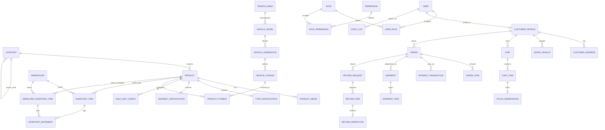

# Domain Model: Pinnacle E-Commerce

## 1. Domain Model Overview

The domain model reflects the operational realities of automotive parts e-commerce. Key design characteristics include:

- Clear separation between **Product Definitions** (catalogue information) and **Physical Stock** (actual warehouse inventory).
- Support for two distinct physical inventory modalities:
  - **Bulk / Quantity Items** (e.g., brand-new tyres), tracked by aggregate count per location.
  - **Individually Serialized Items** (e.g., used/reconditioned seat belts), tracked by unique stock barcode, condition grade, notes, and individual photos.
- **Sale Unit Multipliers**: Decouples how a product is sold (Single = 1 unit, Pair = 2 units, Set of 4 = 4 units) from the underlying base inventory units consumed.
- **Fitment Matrix**: Bidirectional mapping between products and vehicle taxonomy, explicitly tracking verification confidence.

---

## 2. Entity-Relationship Diagram (ERD)

---

## 3. Entity Definitions & Attribute Specifications

### 3.1 Catalogue & Specifications

#### `Category`

Represents the hierarchical classification of parts.

- `id` (UUID, PK)
- `parent_id` (UUID, Nullable, FK to `Category`)
- `slug` (String, Unique)
- `name` (String)
- `description` (Text, Nullable)
- `display_order` (Integer)
- `is_active` (Boolean)
- `created_at` / `updated_at` (Timestamp)

#### `Product`

The master catalogue entry for an automotive part.

- `id` (UUID, PK)
- `category_id` (UUID, FK to `Category`)
- `sku` (String, Unique) — Base product identifier.
- `title` (String)
- `slug` (String, Unique)
- `brand` (String)
- `oem_part_number` (String, Nullable)
- `description` (Text)
- `product_type` (Enum: `BULK_QUANTITY`, `INDIVIDUALLY_SERIALIZED`)
- `status` (Enum: `DRAFT`, `PUBLISHED`, `ARCHIVED`)
- `created_at` / `updated_at` (Timestamp)

#### `TyreSpecification`

Dimensional and performance attributes for tyres.

- `id` (UUID, PK)
- `product_id` (UUID, Unique, FK to `Product`)
- `section_width` (Integer) — e.g., 205 (mm)
- `aspect_ratio` (Integer) — e.g., 55 (%)
- `rim_diameter` (Integer) — e.g., 16 (inches)
- `load_index` (Integer) — e.g., 91
- `speed_rating` (String) — e.g., 'V', 'W', 'H'
- `season` (Enum: `SUMMER`, `WINTER`, `ALL_SEASON`)
- `terrain_type` (Enum: `HIGHWAY`, `ALL_TERRAIN`, `MUD_TERRAIN`, `PERFORMANCE`)
- `run_flat` (Boolean)
- `extra_load` (Boolean) — XL rating
- `fuel_efficiency_class` (String, Nullable) — A to E
- `wet_grip_class` (String, Nullable) — A to E
- `noise_db` (Integer, Nullable)

#### `SeatBeltSpecification`

Attributes specific to safety restraints and seat belts.

- `id` (UUID, PK)
- `product_id` (UUID, Unique, FK to `Product`)
- `position` (Enum: `FRONT_LEFT_DRIVER`, `FRONT_RIGHT_PASSENGER`, `REAR_LEFT`, `REAR_RIGHT`, `REAR_CENTER`, `THIRD_ROW_LEFT`, `THIRD_ROW_RIGHT`)
- `component_type` (Enum: `RETRACTOR_ASSEMBLY`, `BUCKLE_STALK`, `LAP_BELT`, `COMPLETE_ASSEMBLY`)
- `pretensioner_type` (Enum: `PYROTECHNIC`, `MECHANICAL`, `NONE`)
- `webbing_color` (String)
- `mounting_points` (Integer) — e.g., 2-point, 3-point
- `oem_reference_tag` (String, Nullable)

#### `ProductMedia`

Images and technical diagrams.

- `id` (UUID, PK)
- `product_id` (UUID, FK to `Product`)
- `s3_key` (String)
- `cdn_url` (String)
- `alt_text` (String)
- `display_order` (Integer)
- `is_primary` (Boolean)
- `created_at` (Timestamp)

---

### 3.2 Sale Units & Consumption Rules

#### `SaleUnitConfig`

Defines how a catalogue product is presented and sold to the buyer.

- `id` (UUID, PK)
- `product_id` (UUID, FK to `Product`)
- `code` (String) — e.g., `TYRE_SINGLE`, `TYRE_PAIR`, `TYRE_SET_OF_4`
- `name` (String) — e.g., "Single Tyre", "Pair of 2 Tyres", "Set of 4 Tyres"
- `base_quantity_multiplier` (Integer) — Number of physical base units consumed (1, 2, or 4).
- `retail_price` (Decimal(10,2)) — Customer purchase price for this pack.
- `compare_at_price` (Decimal(10,2), Nullable) — Strike-through price for promotions.
- `is_default` (Boolean)
- `is_active` (Boolean)

---

### 3.3 Physical Inventory & Tracking

#### `Warehouse`

Storage facility locations.

- `id` (UUID, PK)
- `code` (String, Unique) — e.g., `SYD-MAIN`, `MEL-DEPOT`
- `name` (String)
- `address_line1`, `city`, `state`, `postal_code`, `country` (String)
- `is_active` (Boolean)

#### `InventoryItem` (Bulk / Aggregated Stock - Tyres)

- `id` (UUID, PK)
- `product_id` (UUID, FK to `Product`)
- `warehouse_id` (UUID, FK to `Warehouse`)
- `location_bin` (String) — e.g., `AISLE-04-SHELF-B`
- `quantity_on_hand` (Integer) — Physical stock in building.
- `quantity_reserved` (Integer) — Soft reserved or pending dispatch.
- `cost_price` (Decimal(10,2)) — Unit wholesale acquisition price (protected by RBAC).
- `created_at` / `updated_at` (Timestamp)

#### `SerializedInventoryItem` (Individually Tracked Items - Used Seat Belts)

- `id` (UUID, PK)
- `product_id` (UUID, FK to `Product`)
- `warehouse_id` (UUID, FK to `Warehouse`)
- `stock_barcode` (String, Unique) — Unique physical scan barcode / serial tag.
- `donor_vehicle_vin` (String, Nullable) — VIN of vehicle from which part was harvested.
- `condition_grade` (Enum: `NEW_SURPLUS`, `GRADE_A_LIKE_NEW`, `GRADE_B_MINOR_WEAR`, `GRADE_C_FUNCTIONAL_BLEMISH`)
- `condition_notes` (Text) — Detailed inspection findings.
- `pretensioner_resistance_ohms` (Decimal(4,2), Nullable) — Electrical continuity test reading.
- `actual_photos` (JSONB) — Array of S3 URLs showing actual item angles and serial tags.
- `location_bin` (String)
- `cost_price` (Decimal(10,2)) — Acquisition / harvest cost.
- `status` (Enum: `AVAILABLE`, `RESERVED`, `SOLD`, `SCRAPPED`, `UNDER_INSPECTION`)
- `created_at` / `updated_at` (Timestamp)

#### `InventoryMovement`

Immutable ledger of all stock changes.

- `id` (UUID, PK)
- `inventory_item_id` (UUID, Nullable, FK to `InventoryItem`)
- `serialized_item_id` (UUID, Nullable, FK to `SerializedInventoryItem`)
- `movement_type` (Enum: `RECEIPT`, `SALE_DEDUCTION`, `RESERVATION_HOLD`, `RESERVATION_RELEASE`, `MANUAL_ADJUSTMENT`, `RETURN_RESTOCK`, `SCRAP_WRITEOFF`)
- `quantity_change` (Integer) — Positive or negative integer.
- `previous_quantity` (Integer)
- `new_quantity` (Integer)
- `reason_code` (String)
- `operator_id` (UUID, FK to `User`)
- `reference_order_id` (UUID, Nullable)
- `created_at` (Timestamp)

---

### 3.4 Vehicle Fitment & Taxonomy

#### `VehicleMake`

- `id` (UUID, PK)
- `name` (String, Unique) — e.g., "Toyota", "Ford", "BMW"
- `slug` (String, Unique)

#### `VehicleModel`

- `id` (UUID, PK)
- `make_id` (UUID, FK to `VehicleMake`)
- `name` (String) — e.g., "RAV4", "Ranger", "3 Series"
- `slug` (String)

#### `VehicleGeneration`

- `id` (UUID, PK)
- `model_id` (UUID, FK to `VehicleModel`)
- `generation_name` (String) — e.g., "5th Gen (XA50)"
- `year_start` (Integer) — e.g., 2018
- `year_end` (Integer, Nullable) — e.g., 2024 or Null if current

#### `VehicleChassis`

- `id` (UUID, PK)
- `generation_id` (UUID, FK to `VehicleGeneration`)
- `chassis_code` (String) — e.g., "MXAA52", "AXAH54"
- `body_type` (String) — e.g., "SUV 5-door", "Sedan"
- `engine_spec` (String, Nullable) — e.g., "2.5L Hybrid A25A-FXS"

#### `ProductFitment`

Maps products to vehicles with verification confidence.

- `id` (UUID, PK)
- `product_id` (UUID, FK to `Product`)
- `vehicle_chassis_id` (UUID, FK to `VehicleChassis`)
- `verification_status` (Enum: `VERIFIED_OEM_DIRECT`, `UNIVERSAL_FIT`, `REQUIRES_CHECK`)
- `fitment_notes` (String, Nullable) — e.g., "Only fits models equipped with factory aero kit."
- `verified_by_user_id` (UUID, Nullable, FK to `User`)
- `verified_at` (Timestamp, Nullable)

---

### 3.5 Customer, Cart & Reservations

#### `CustomerProfile`

- `id` (UUID, PK)
- `user_id` (UUID, Unique, FK to `User`)
- `first_name` (String)
- `last_name` (String)
- `phone` (String, Nullable)
- `account_type` (Enum: `RETAIL`, `TRADE_COMMERCIAL`)
- `created_at` / `updated_at` (Timestamp)

#### `SavedVehicle` (Customer Garage)

- `id` (UUID, PK)
- `customer_id` (UUID, FK to `CustomerProfile`)
- `vehicle_chassis_id` (UUID, FK to `VehicleChassis`)
- `nickname` (String, Nullable) — e.g., "My Daily RAV4"
- `registration_plate` (String, Nullable)
- `is_primary` (Boolean)

#### `Cart` & `CartItem`

- `Cart`: `id`, `customer_id` (Nullable for guest carts), `session_token` (String, Unique), `currency`, `created_at`, `expires_at`.
- `CartItem`:
  - `id` (UUID, PK)
  - `cart_id` (UUID, FK to `Cart`)
  - `product_id` (UUID, FK to `Product`)
  - `sale_unit_config_id` (UUID, FK to `SaleUnitConfig`)
  - `serialized_item_id` (UUID, Nullable, FK to `SerializedInventoryItem`)
  - `quantity` (Integer)
  - `unit_price` (Decimal(10,2))
  - `created_at` (Timestamp)

#### `StockReservation`

Time-limited hold during checkout.

- `id` (UUID, PK)
- `cart_item_id` (UUID, Unique, FK to `CartItem`)
- `inventory_item_id` (UUID, Nullable, FK to `InventoryItem`)
- `serialized_item_id` (UUID, Nullable, FK to `SerializedInventoryItem`)
- `reserved_quantity` (Integer)
- `expires_at` (Timestamp) — e.g., `now() + 15 minutes`
- `status` (Enum: `ACTIVE`, `RELEASED`, `CONVERTED_TO_ORDER`)

---

### 3.6 Orders, Payments & Fulfillment

#### `Order`

- `id` (UUID, PK)
- `order_number` (String, Unique) — Human-readable, e.g., `PIN-2026-10042`
- `customer_id` (UUID, Nullable for guest, FK to `CustomerProfile`)
- `customer_email` (String)
- `customer_phone` (String)
- `shipping_address` (JSONB)
- `billing_address` (JSONB)
- `order_status` (Enum: `PENDING_PAYMENT`, `PAID`, `PROCESSING`, `SHIPPED`, `DELIVERED`, `CANCELLED`, `REFUNDED`)
- `payment_status` (Enum: `UNPAID`, `AUTHORIZED`, `PAID`, `PARTIALLY_REFUNDED`, `REFUNDED`, `FAILED`)
- `fulfillment_status` (Enum: `UNFULFILLED`, `PARTIALLY_FULFILLED`, `FULFILLED`)
- `subtotal` (Decimal(10,2))
- `shipping_fee` (Decimal(10,2))
- `tax_amount` (Decimal(10,2))
- `total_amount` (Decimal(10,2))
- `currency` (String, default: "AUD" or "USD")
- `created_at` / `updated_at` (Timestamp)

#### `OrderItem`

- `id` (UUID, PK)
- `order_id` (UUID, FK to `Order`)
- `product_id` (UUID, FK to `Product`)
- `sale_unit_config_id` (UUID, FK to `SaleUnitConfig`)
- `serialized_item_id` (UUID, Nullable, FK to `SerializedInventoryItem`)
- `sku` (String)
- `title` (String)
- `quantity` (Integer) — Count of sale units purchased.
- `base_units_consumed` (Integer) — Total raw inventory units depleted (`multiplier * quantity`).
- `unit_price` (Decimal(10,2))
- `total_price` (Decimal(10,2))

#### `PaymentTransaction`

- `id` (UUID, PK)
- `order_id` (UUID, FK to `Order`)
- `provider` (Enum: `STRIPE`, `PAYPAL`, `MANUAL`)
- `transaction_reference` (String, Unique) — Gateway transaction / payment intent ID.
- `idempotency_key` (String, Unique)
- `amount` (Decimal(10,2))
- `currency` (String)
- `status` (Enum: `SUCCESS`, `PENDING`, `FAILED`, `REFUNDED`)
- `raw_response` (JSONB)
- `created_at` (Timestamp)

#### `Shipment` & `ShipmentItem`

- `Shipment`: `id`, `order_id`, `carrier_name`, `tracking_number`, `tracking_url`, `shipped_at`, `status`.
- `ShipmentItem`: `id`, `shipment_id`, `order_item_id`, `quantity_shipped`.

---

### 3.7 Returns & RMAs

#### `ReturnRequest` (RMA)

- `id` (UUID, PK)
- `rma_number` (String, Unique) — e.g., `RMA-2026-0042`
- `order_id` (UUID, FK to `Order`)
- `customer_id` (UUID, FK to `CustomerProfile`)
- `reason_code` (Enum: `INCORRECT_FITMENT`, `DEFECTIVE_PART`, `DAMAGED_IN_SHIPPING`, `CUSTOMER_CHANGED_MIND`)
- `customer_notes` (Text)
- `proof_photos` (JSONB) — S3 image URLs of customer issue.
- `status` (Enum: `PENDING_REVIEW`, `APPROVED`, `REJECTED`, `RECEIVED_AWAITING_INSPECTION`, `RESOLVED`, `CLOSED`)
- `created_at` / `updated_at` (Timestamp)

#### `ReturnInspection`

- `id` (UUID, PK)
- `return_item_id` (UUID, Unique)
- `inspector_id` (UUID, FK to `User`)
- `disposition` (Enum: `RESTOCK_TO_INVENTORY`, `SCRAP_WRITEOFF`, `RETURN_TO_SENDER`)
- `inspection_notes` (Text)
- `refund_eligible` (Boolean)
- `completed_at` (Timestamp)

---

### 3.8 Identity, RBAC & Audit

#### `User`, `Role`, `Permission`, `UserRole`, `RolePermission`

- `User`: `id`, `email` (Unique), `password_hash`, `is_active`, `is_staff`, `last_login_at`.
- `Role`: `id`, `key` (Unique, e.g. `INVENTORY_MGR`), `name`, `description`.
- `Permission`: `id`, `code` (Unique, e.g. `inventory:stock:adjust`), `description`, `domain`.
- Standard junction tables `UserRole` and `RolePermission`.

#### `AuditLog`

Append-only log for compliance.

- `id` (UUID, PK)
- `actor_id` (UUID, Nullable, FK to `User`)
- `ip_address` (String)
- `user_agent` (String)
- `domain` (String) — e.g., `inventory`, `orders`, `pricing`
- `action` (String) — e.g., `inventory:stock:adjust`
- `entity_type` (String) — e.g., `InventoryItem`
- `entity_id` (String)
- `before_state` (JSONB, Nullable)
- `after_state` (JSONB, Nullable)
- `created_at` (Timestamp, Default: `now()`)
