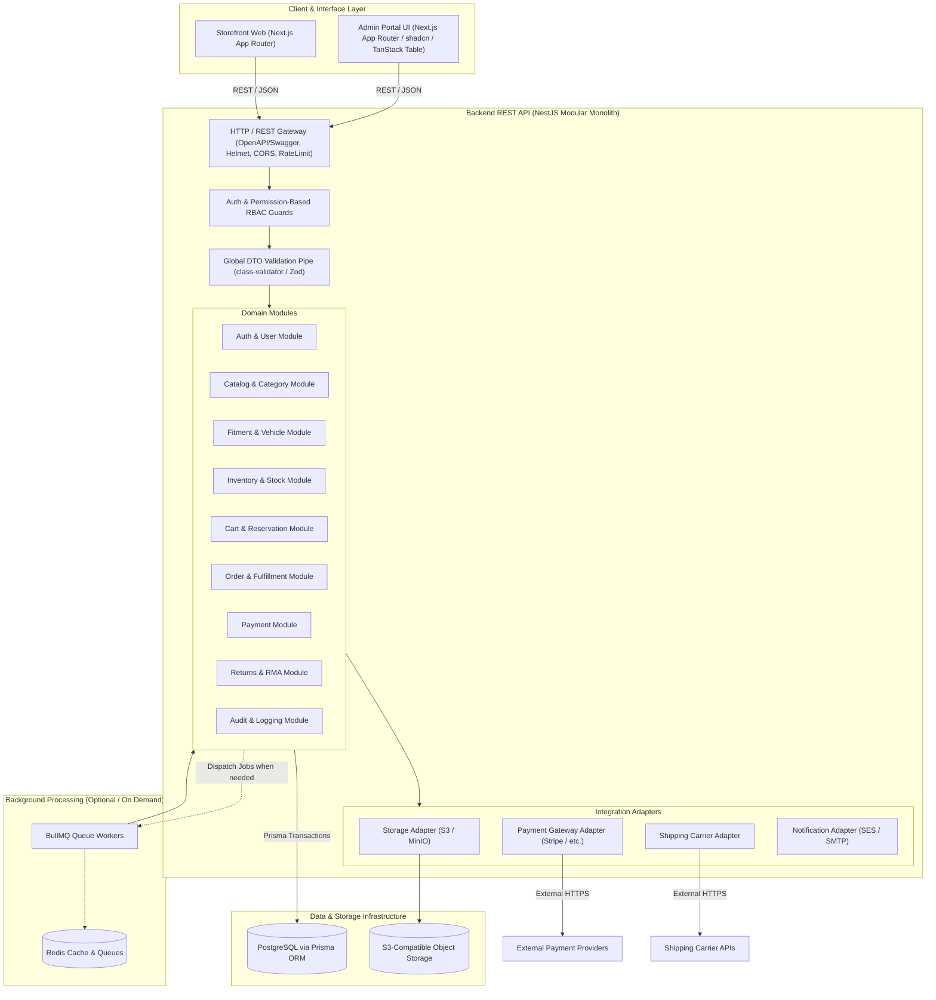

# System Architecture: Pinnacle E-Commerce

## 1. Architectural Style & Overview

Pinnacle E-Commerce is designed as a **Modular Monolith**.

Rather than deploying complex, distributed microservices with independent databases and network latency overheads, the application encapsulates domain business rules into well-defined, strictly isolated NestJS modules sharing a unified PostgreSQL database via Prisma ORM.

The frontend is a dedicated Next.js (App Router) web application. The frontend communicates with the backend exclusively via HTTPS REST API calls; the browser and frontend server **never** connect directly to the PostgreSQL database.

---

## 2. Layer Specifications

### 2.1 Frontend: Next.js App Router

- **Routing & Rendering**: Next.js App Router with React Server Components (RSC) for high-performance public catalogue pages (SEO-optimized, pre-rendered data fetching) and Client Components (`"use client"`) for interactive elements (vehicle selectors, cart drawers, admin data tables, interactive forms).
- **Styling & UI Components**: Tailwind CSS for responsive utility styling, coupled with `shadcn/ui` components built on Radix UI primitives. Lucide React for consistent, crisp iconography.
- **State Management & Caching**:
  - **Server State**: `@tanstack/react-query` for all client-side data fetching, optimistic mutations, cache invalidation, and background synchronization.
  - **Client State**: Local state (React `useState`, `useReducer`, or Zustand if cross-component shared state is required).
- **Forms & Validation**: `react-hook-form` integrated with `zod` schema resolvers. Client-side schemas mirror API DTO validation rules.
- **Admin Tables**: `@tanstack/react-table` for high-density administrative tabular data, supporting column sorting, multi-attribute filtering, pagination, and row selection.

### 2.2 Backend: NestJS Modular Monolith

- **Framework Core**: NestJS in strict TypeScript mode.
- **Controllers & Routing**: Resource-based controllers providing clean RESTful endpoints.
- **Input Validation**: Global `ValidationPipe` with `whitelist: true`, `forbidNonWhitelisted: true`, and `transform: true`. All input payloads map to explicit TypeScript DTO classes with `class-validator` decorators.
- **API Documentation**: Automated OpenAPI 3.0 generation via `@nestjs/swagger`. All request payloads, response schemas, and error shapes are fully annotated.
- **Security & Authorization**:
  - Global `JwtAuthGuard` validates session tokens.
  - Custom `@RequirePermissions('permission:name')` decorator and `PermissionsGuard` evaluate caller permissions against the database-backed role/permission model.
  - Ownership guards ensure customer tokens can never access another customer's cart, orders, or profile.
- **Exception Handling**: Global exception filter mapping domain errors (e.g., `OutOfStockException`, `FitmentMismatchException`, `PermissionDeniedException`) to consistent RFC 7807 problem details payloads.
- **Audit Interceptor**: Automatically captures mutations to sensitive entities and persists them to the `AuditLog` table.

### 2.3 Data Layer: PostgreSQL & Prisma ORM

- **Database Engine**: PostgreSQL 16+.
- **ORM**: Prisma ORM with strict typing.
- **Prisma Entities**: Prisma entities are **never** returned raw to the API clients. Controllers map database records to clean, versioned DTOs to prevent inadvertent data leakage (e.g., internal cost prices, password hashes, internal status notes).
- **Transactions**: Multi-table operations (inventory deduction, order creation, payment capture, returns disposition) use explicit `prisma.$transaction([ ... ])` or interactive transactions (`prisma.$transaction(async (tx) => { ... })`).
- **Migration Strategy**: Forward-only, reviewed migrations (`prisma migrate dev` locally, `prisma migrate deploy` in CI/CD and production).

### 2.4 Object Storage: S3-Compatible

- **Storage Strategy**: Product photographs, inspection photos of used seat belts, return defect images, and generated invoices are stored in an S3-compatible bucket (MinIO for local development; AWS S3 for production).
- **Decoupled Access**: The API server does not buffer large file uploads through application memory. Clients request pre-signed upload URLs (`POST /api/v1/media/presign-upload`) via `StorageService`. Clients upload directly to the bucket, and subsequently attach the returned S3 object key to the domain entity.

### 2.5 Background Jobs: BullMQ + Redis (On-Demand)

- **Principle**: BullMQ and Redis are introduced **only** when background jobs are actually needed.
- **Target Use Cases**:
  - Generating image thumbnails and responsive resolutions for seat belt inspection photos.
  - Outbound email notifications via transactional mailers (SES).
  - Asynchronous webhook deliveries to third-party shipping carriers.
  - Scheduled cleanup of expired cart stock reservations.

### 2.6 External Integration Adapters

All external provider communications are strictly wrapped behind provider-agnostic TypeScript interfaces:

- `PaymentGatewayAdapter`: Abstraction for card charging, pre-authorizations, captures, and refunds. Allows swapping Stripe, Adyen, or PayPal without modifying the `PaymentModule`.
- `ShippingCarrierAdapter`: Abstraction for rate calculation, booking shipments, and generating courier tracking links.
- `NotificationAdapter`: Abstraction for email, SMS, and template dispatching.

---

## 3. Module Boundaries & Ownership Matrix

To maintain the architectural integrity of the modular monolith, strict module boundaries are defined below. No module may execute queries against tables owned by another module directly. All cross-module interactions must occur via public service methods or published domain events.

| Module Name           | Owned Entities                                                                                                            | Owned Business Rules & Data Operations                                                                                      | Prohibited Operations (Must Delegate)                                             |
| --------------------- | ------------------------------------------------------------------------------------------------------------------------- | --------------------------------------------------------------------------------------------------------------------------- | --------------------------------------------------------------------------------- |
| **`AuthModule`**      | `User`, `Role`, `Permission`, `RolePermission`, `UserRole`, `StaffProfile`                                                | Authentication, password hashing, token issuance, permission checking, staff user provisioning.                             | Must not touch customer carts or orders directly.                                 |
| **`CustomerModule`**  | `CustomerProfile`, `CustomerAddress`, `SavedVehicle` (Garage)                                                             | Customer profile management, saved vehicle garage, address book validation, GDPR anonymization.                             | Must not modify order states or process payments.                                 |
| **`CatalogModule`**   | `Category`, `Product`, `ProductSpecification`, `ProductMedia`                                                             | Category trees, tyre specs, seat belt specs, product lifecycle (`DRAFT`/`PUBLISHED`), SEO metadata.                         | Must not store physical stock counts or warehouse bins.                           |
| **`FitmentModule`**   | `VehicleMake`, `VehicleModel`, `VehicleYearGeneration`, `VehicleChassis`, `ProductFitment`                                | Vehicle taxonomy, product-vehicle compatibility mapping, fitment verification status (`VERIFIED_OEM`, `UNIVERSAL`).         | Must not modify catalogue product prices or stock.                                |
| **`InventoryModule`** | `Warehouse`, `InventoryItem` (bulk tyres), `SerializedInventoryItem` (seat belts), `InventoryMovement`, `StockAdjustment` | Physical stock levels, bin/shelf locations, serialized item condition notes, stock receipt, manual adjustments, write-offs. | Must not compute order totals or initiate customer payments.                      |
| **`SaleUnitModule`**  | `SaleUnitConfig` (single, pair, set)                                                                                      | Computes base inventory consumption multipliers (`multiplier * qty`), determines dynamic buyable stock.                     | Must not modify warehouse physical bin inventory directly.                        |
| **`CartModule`**      | `Cart`, `CartItem`, `StockReservation`                                                                                    | Cart persistence, guest-to-customer cart merge, time-limited soft reservations on inventory, reservation timeout release.   | Must not issue courier labels or charge credit cards.                             |
| **`OrderModule`**     | `Order`, `OrderItem`, `OrderHistoryEntry`, `OrderFulfillment`                                                             | Order state machine progression, permanent stock allocation, order picking/packing slips, order cancellation rules.         | Must not interact directly with raw payment gateways (must call `PaymentModule`). |
| **`PaymentModule`**   | `PaymentTransaction`, `PaymentWebhookLog`                                                                                 | Interfacing with payment gateways via adapter, handling cryptographic webhook validation, refund transaction recording.     | Must not mark orders as shipped or adjust physical stock.                         |
| **`ShippingModule`**  | `ShippingCarrier`, `Shipment`, `ShipmentItem`, `ShippingRateRule`                                                         | Shipping rate quotes, parcel weight/dimension aggregation, tracking number generation, Click & Collect depot management.    | Must not alter product prices.                                                    |
| **`ReturnModule`**    | `ReturnRequest` (RMA), `ReturnItem`, `ReturnInspection`                                                                   | RMA workflow, photo defect review, return authorization, physical inspection disposition (restock vs scrap).                | Must not perform unverified automatic refunds.                                    |
| **`AuditModule`**     | `AuditLog`                                                                                                                | Append-only audit record creation, actor capture, IP capture, before/after JSON diffs.                                      | Must not be updated or deleted by any user or module.                             |

---

## 4. Cross-Module Communication Rules

1. **In-Process Dependency Injection**: Modules expose a clean `@Injectable()` service interface (e.g., `InventoryService.reserveStock(...)`, `PaymentService.createCharge(...)`). Modules requiring this capability import the owning module and inject the service interface.
2. **Database Isolation**: The Prisma client schema may define relations between tables for foreign key integrity, but repository queries within `OrderModule` must **never** execute raw updates against `InventoryItem` or `User` tables.
3. **Domain Events**: Where actions trigger asynchronous secondary effects (e.g., `OrderPlacedEvent` triggering email confirmation and pick list generation), internal NestJS `EventEmitter2` events are emitted.
